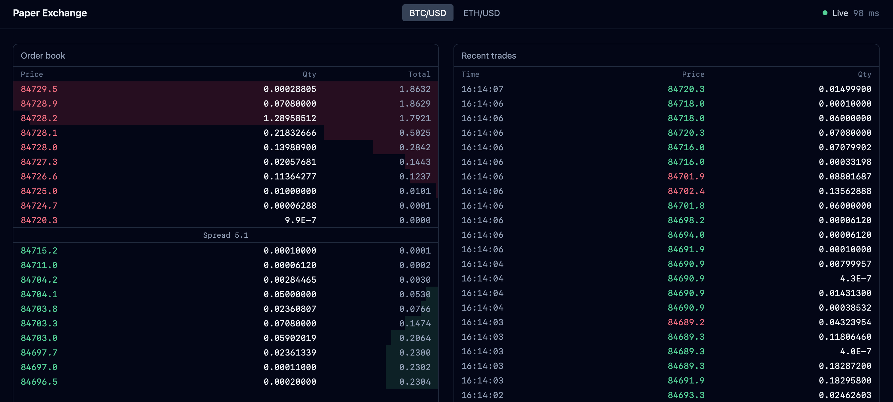
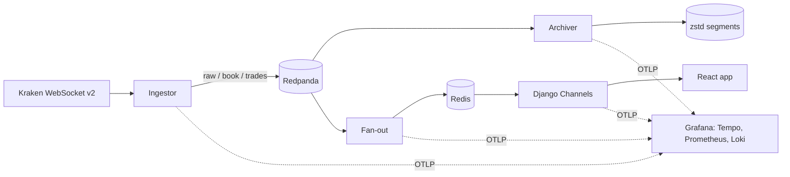
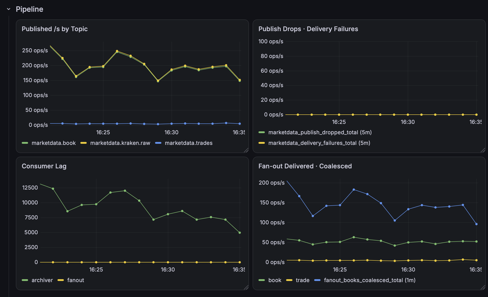

# Live Paper-Trading Exchange

A paper-trading exchange on live crypto market data, built to explore market infrastructure:
event logs, exactly-once archiving, real-time fan-out and end-to-end observability.



## What it does

- Streams live Level 2 order books and trades for BTC/USD and ETH/USD from Kraken over one
  WebSocket connection, verifying every update against Kraken's CRC32 checksum and
  resyncing automatically on mismatch.
- Publishes raw, verified-book and trade events to Redpanda (Kafka API), partitioned by
  instrument.
- Archives every raw message to compressed, offset-named segment files with no gaps or duplicates (verified by `manage.py verify_archive`).
- Fans live books out to browsers over Django Channels, with per-client conflation.

Paper trading (accounts, orders, fills, double-entry ledger) is next.

## Architecture



## Measured performance

100 concurrent WebSocket clients, 10 minutes, live market data (21 October 2026):

| Measure                                   | p50     | p99      |
| ----------------------------------------- | ------- | -------- |
| Pipeline: ingest → broadcast              | 7.1 ms  | 14.6 ms  |
| Delivered: ingest → client                | 38 ms   | 142.7 ms  |




## Running it

Requirements: Docker, plus uv and Node 24 for development.

```bash
cp .env.example .env    # then fill in the values
docker compose --profile app up -d --build
```

| What                       | Where                  |
| -------------------------- | ---------------------- |
| App                        | http://localhost:8081  |
| Grafana (dashboards, traces) | http://localhost:3000 |
| Redpanda Console           | http://localhost:8080  |


## Tests

```bash
uv run pytest
cd frontend && pnpm test
```
