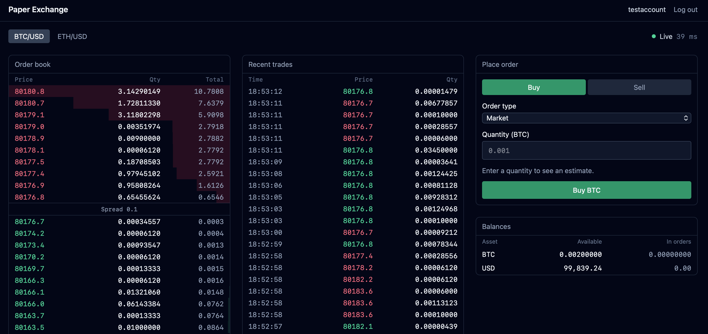
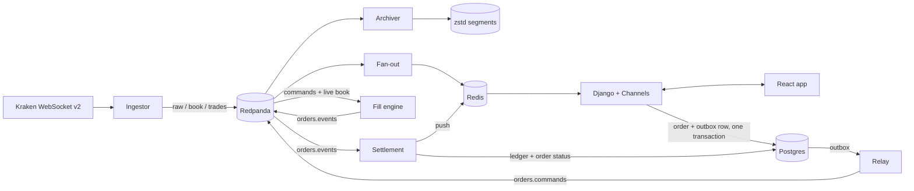

# Live Paper-Trading Exchange

A paper-trading exchange on live crypto market data, built to explore market infrastructure:
event logs, exactly-once processing, a double-entry ledger, real-time fan-out and end-to-end
observability.



## What it does

**Market data**

- Streams live Level 2 order books (100 levels) and trades for BTC/USD and ETH/USD from
  Kraken over one WebSocket connection, verifying every update against Kraken's CRC32
  checksum and resyncing automatically on mismatch.
- Publishes raw, verified-book and trade events to Redpanda (Kafka API), partitioned by
  instrument.
- Archives every raw message to compressed, offset-named segment files with no gaps or
  duplicates (verified by `manage.py verify_archive`).
- Fans live books out to browsers over Django Channels, with per-client conflation.

**Paper trading**

- Sign up and get $100,000 of paper money. Place market and limit orders against the real
  Kraken book; cancel resting orders.
- Market orders fill by walking the live book. Limit orders fill at once if the book allows,
  otherwise they rest until the market trades through their price.
- Every balance change is a balanced double-entry ledger transaction. Funds are reserved
  when an order is placed, and fills, fees (0.25%) and refunds settle in one transaction.
- Orders and balances update live in the browser over an authenticated WebSocket.

## Architecture



### How an order flows

1. **API:** the order, the reserved funds and an outbox event are written in **one
   Postgres transaction**, keyed by the client's `Idempotency-Key`.
2. **Relay:** publishes committed outbox events to Redpanda, woken by `LISTEN/NOTIFY`.
3. **Fill engine:** decides each order against the live book and publishes the outcome:
   accepted, filled, rejected or cancelled.
4. **Settlement:** applies each outcome to the order and the ledger in one transaction, then
   pushes the update to the user's browser.

## Measured performance

100 concurrent WebSocket clients, 10 minutes, live market data (21 October 2026):

| Measure                       | p50    | p99      |
| ----------------------------- | ------ | -------- |
| Pipeline: ingest → broadcast  | 7.1 ms | 14.6 ms  |
| Delivered: ingest → client    | 38 ms  | 142.7 ms |


## Running it

Requirements: Docker, plus uv and Node 24 for development.

```bash
cp .env.example .env    # then fill in the values
docker compose --profile app up -d --build
```

Then open the app and sign up to start trading.

| What                         | Where                 |
| ---------------------------- | --------------------- |
| App                          | http://localhost:8081 |
| Grafana (dashboards, traces) | http://localhost:3000 |
| Redpanda Console             | http://localhost:8080 |


## Tests

```bash
uv run pytest            # backend, including property-based ledger and settlement tests
uv run mypy .
cd frontend && pnpm test
```
